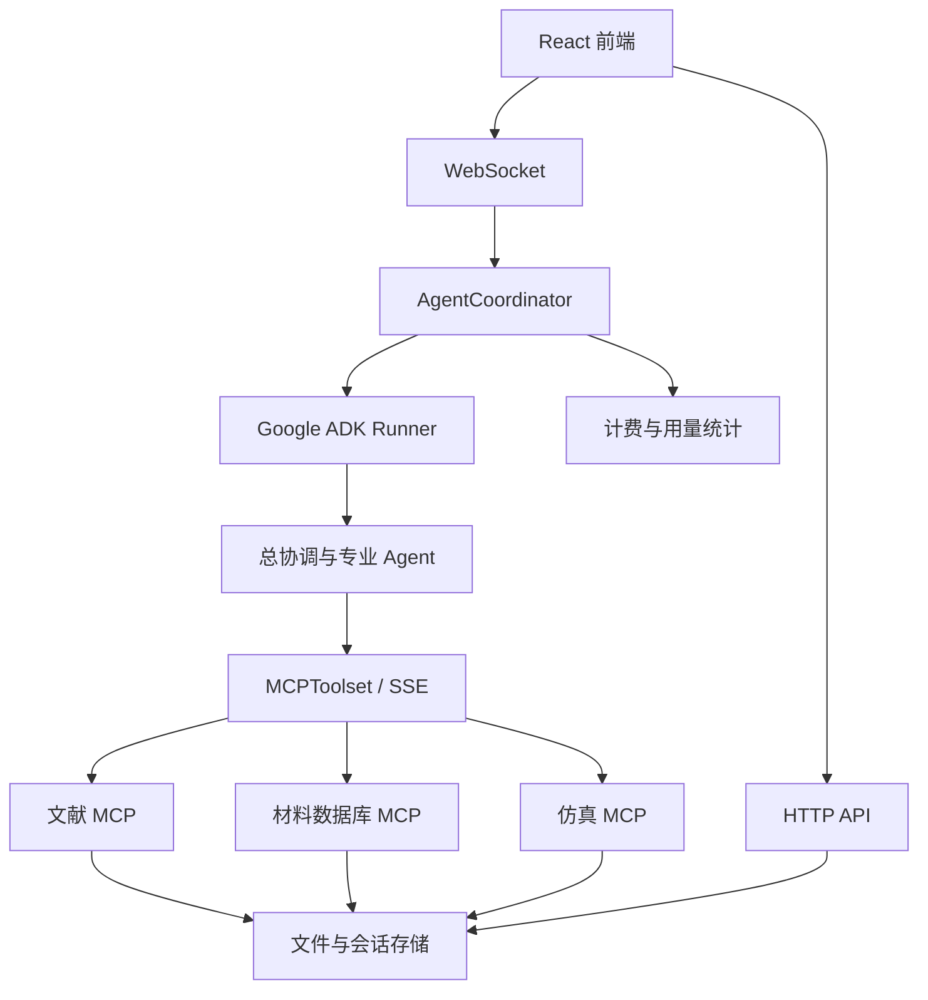
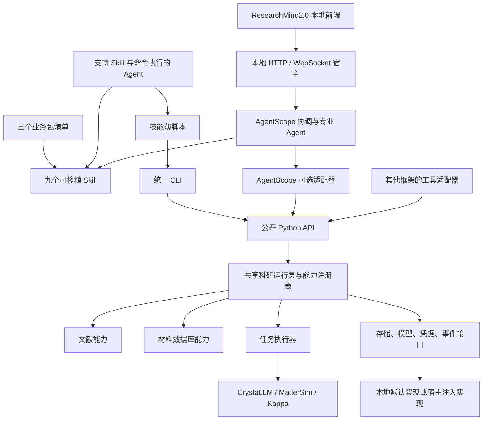

# ResearchMind2.0 MCP 转可移植 Skill 与 AgentScope 首批适配开发文档

| 项目 | 内容 |
|---|---|
| 文档版本 | v1.2 |
| 首版日期 | 2026-11-19 |
| 修订日期 | 2026-11-20 |
| 当前实施仓库 | [crjia111/ResearchMind2.0](https://github.com/crjia111/ResearchMind2.0) |
| 本地仓库基线 | `ce3e2ff8309a7c9fdc79e42800b8846c8d0bfe35`（main） |
| 历史完整审阅基线 | [Jack-Liu0227/ResearchMind](https://github.com/Jack-Liu0227/ResearchMind)，`be1d615361aa42df1a45fdc7f7ae68e8448f48fc` |
| 建设目标 | 框架无关的 Skill 包和运行层，首批提供 AgentScope 适配 |
| AgentScope 适配设计基线 | `v2.0.12`，实施时再次核对所选版本 |
| 文档状态 | 待实施的开发设计 |
| 本轮操作范围 | 文档修订和少量源码复核；未实施迁移、安装技能或执行计算 |
| 本版调整 | 保留三个业务包/九个 Skill；正式 CLI/Python API、可选框架适配、跨框架验收；对齐 2.0 本地无认证与无平台扣费 |

> 新目录、接口、命令、版本号和配置项均为拟开发设计，不代表当前已实现。跨框架能力必须满足宿主执行能力和科研环境要求，不能承诺任意 Agent 安装即用。

## 1. 建设目标与范围

建设 **框架无关的 Skill 包和科研运行层，首批提供 AgentScope 适配**。首个应用落点是 ResearchMind2.0 的本地运行版本，将原 Google ADK 智能体接入替换为 AgentScope；可复用的 Skill 和科研实现独立于这次宿主框架迁移。

首期采用 **三个可安装业务包 + 九个工作流 Skill + 共享科研运行层 + 正式支持的 CLI / Python API + 可选框架适配器**。

| 业务包 ID | 内含 Skill | 数量 |
|---|---|---:|
| `researchmind-literature` | `literature-search`、`paper-analysis`、`research-report`、`literature-knowledge` | 4 |
| `researchmind-materials-db` | `materials-search` | 1 |
| `researchmind-simulation` | `crystal-generation`、`structure-optimization`、`phonon-analysis`、`thermal-conductivity` | 4 |
| 合计 | 九个独立技能目录，共享一套科研运行层 | 9 |

业务包是安装集合（bundle），不要求拆成三个 Python wheel。首期由一个 `researchmind-skills` wheel 承载运行层、CLI、三个业务包清单、九个 Skill 资源及可选适配器代码；AgentScope 依赖通过 extra 显式安装。业务包名称不是可触发的 Skill 名称。

迁移应达到以下结果：

1. 九个 Skill 采用可移植的 `SKILL.md`、参考文件和薄脚本，不把 AgentScope 的工具名称或类名写成通用执行前提。
2. CLI 与 Python API 在未安装 AgentScope、Google ADK、FastMCP，且不启动 ResearchMind Web 服务的环境中可独立运行。
3. 支持该 Skill 目录格式并允许执行 Python / CLI 的 Agent，可以安装相同资源并通过统一入口执行；仅支持函数工具的框架可另接工具适配器。
4. 首批提供 AgentScope 工具注册、结果转换、事件桥接和五类业务 Agent 工厂，完成 ResearchMind2.0 的应用迁移。
5. 新链路无需启动原三个 MCP 服务；科研实现不依赖原仓库工作目录。
6. 保留聊天、附件、预览、结构展示、任务进度和会话恢复，沿用 2.0 的本地无登录、无平台扣费模式，统计模型和计算用量。
7. 每项原能力都有主负责 Skill、共享工具或维护入口；按实际任务验证路由、证据、结果和跨入口一致性。

“跨框架”不等于“任意 Agent 安装即用”：宿主必须能发现或加载 Skill，并具备相应命令执行或工具调用能力；科研依赖、凭据、模型和计算资源也必须可用。首期正式集成的框架是 AgentScope，其他框架的兼容声明应列明宿主版本、接入方式和验证结果。

本次不增加材料数据库或科研算法，不恢复已移除的登录、平台扣费、充值或配额功能，也不承诺首期为所有框架开发原生适配器。

## 2. 原始审阅与 ResearchMind2.0 基线

### 2.1 审阅范围

v1.0 / v1.1 的完整静态审阅基于原 ResearchMind 提交 `be1d615361aa42df1a45fdc7f7ae68e8448f48fc`，覆盖以下范围。本版迁移目标改为 ResearchMind2.0 提交 `ce3e2ff8309a7c9fdc79e42800b8846c8d0bfe35`。

本轮对 2.0 核对了 README、本地运行说明、依赖声明、三个服务的工具注册数量，以及 CIF 校验、CSV 导出、内容读取的对应源码；未重新完整审阅整个仓库。原始问题和迁移表是覆盖基线，实施阶段仍需对当前版本逐项验证。

2.0 已确认的差异：

- 默认本地单用户，无平台账号、Cookie、AccessKey 登录；第三方模型/数据库凭据仍按能力配置。
- 平台扣费、配额和邀请奖励已移除；保留只读用量统计，不恢复这些功能。
- 数据默认保存在本地配置目录；Redis 可选，服务默认绑定 `127.0.0.1`。
- `pyproject.toml` 已将 wheel 包目录改为 `agents`、`mcp_servers`、`services`、`utils`，原版缺少 `communication` 的声明问题不能继续当作 2.0 的现状。
- 三个 MCP 服务注册数仍为文献 27、数据库 7、仿真 8；数量相同不代表全部行为已验证一致。

原始审阅范围：

- `agents/`：总协调、文献、数据库、仿真和实验规划智能体。
- `mcp_servers/`：三个 MCP 服务、科研业务实现和共享存储。
- `services/`：运行协调、HTTP、WebSocket、会话、文件、认证和计费。
- `ui/src/`：聊天通信、状态存储、结果展示和文献选择入口。
- `utils/`：路径、会话和 URL 辅助逻辑。
- `main.py`、`pyproject.toml`、启动脚本及项目说明。

审阅属于静态分析，未验证当前项目能否完整启动，也未执行模型推理、外部数据库查询或 GPU 计算。模型权重和二进制资源不属于逐行审阅范围。

### 2.2 原项目运行架构（历史基线）



上图计费节点仅描述原版历史架构，2.0 已取消平台扣费；目标架构见第 4 章。

实际工程中还存在旁路：前端文献选择接口会通过 HTTP 直接调用部分实现逻辑，不完全经过 MCP 客户端。

### 2.3 原始智能体职责

| 文件 | 当前职责 |
|---|---|
| `agents/agent.py` | 总协调，通过 `AgentTool` 调用专业智能体 |
| `agents/deep_research_agent/agent.py` | 通过 `MCPToolset` 连接文献服务 |
| `agents/database_agent/agent.py` | 通过 `MCPToolset` 连接数据库服务 |
| `agents/simulation_agent/agent.py` | 通过 `MCPToolset` 连接仿真服务 |
| `agents/experiment_plan_agent/agent.py` | 组合三个专业智能体生成实验规划 |
| `agents/callbacks.py` | 上下文裁剪、证据摘要、模型用量记录 |

因此，实验规划虽然没有独立 MCP 服务，也属于框架迁移范围。

### 2.4 MCP 工具覆盖基线

| 服务文件 | 服务名 | 默认端口 | 实际注册工具数 |
|---|---|---:|---:|
| `mcp_servers/paper_search/server.py` | `paper_search` | 50004 | 27 |
| `mcp_servers/database_call/server.py` | `materials-db` | 50006 | 7 |
| `mcp_servers/simulation/server.py` | `simulation` | 50005 | 8 |
| 合计 | — | — | 42 |

工具数量依据源码装饰器注册统计，本轮已在 2.0 复核，包含辅助工具。具体参数、旁路调用和遗留问题在实施阶段重新确认。

### 2.5 原审阅问题及迁移处理

| 问题 | 源码依据与影响 | 处理要求 |
|---|---|---|
| 工具提示词过期 | 仿真提示词仍引用 `calculate_energy_from_cif`、`batch_calculate_kappa` 等旧入口 | 按新能力注册表统一重写提示词和 Skill 引用 |
| 服务入口包含业务逻辑 | 数据库查询等实现直接写在 `server.py` 中 | 抽离业务逻辑后再接入 Skill |
| 路径依赖仓库布局 | 多处使用 `sys.path` 和相对导入，读取仓库内模型或数据 | 改为包内导入和显式配置路径 |
| 会话历史绑定 ADK | 使用 `types.Content`、ADK 事件及会话服务 | 增加框架无关历史格式和旧格式转换器 |
| 会话上下文依赖线程局部变量 | `agents/callbacks.py` 使用线程局部上下文 | 使用显式上下文传递；异步边界可使用 `ContextVar` |
| 文献进度耦合 WebSocket | 服务代码直接查找 WebSocket 单例并发送消息 | 改为运行时事件接口，由宿主路由到会话 |
| 向量入口使用全局存储 | 入库和检索工具内部设置 `session_id = None` | 按用户、会话或明确授权的知识空间隔离 |
| 向量入库来源不完整 | 当前入口只有 arXiv 内容获取实现，其他来源返回未实现错误 | 首期如实保留支持边界，其他来源返回明确错误 |
| 热导率存在模拟值回退 | 计算库缺失或部分批量异常时返回 `mock`/`mock_batch` | 生产默认禁止模拟结果冒充计算成功 |
| 数据库结构生成已禁用 | `get_structure_recommendations` 仅汇总数据库结果 | 晶体生成统一由仿真技能负责 |
| 原版计费依赖工具名称 | 原版通过工具名和返回字段判断收费，2.0 已移除平台扣费 | 用量按稳定能力编号记录，不恢复扣费模块 |
| 安装包与独立发布 | 原版 communication 声明问题在 2.0 已调整，但当前仍是单体应用包 | 新建框架无关包、可选依赖及可移植安装测试 |

## 3. 核心设计决策

### 3.1 Skill、运行层与框架适配分离

Skill 提供任务说明、流程和资源引用。读取 `SKILL.md` 不会自动运行 Python、注册工具、安装依赖或赋予执行权限。

| 层次 | 内容 | 框架约束 |
|---|---|---|
| 技能层 | 九个 `SKILL.md`、参考资料、薄脚本 | 通用正文引用能力编号和 CLI，不依赖 AgentScope |
| 业务运行层 | 检索、分析、数据库、仿真、任务与工件服务 | 不导入任何 Agent 框架或原宿主服务 |
| 通用执行入口 | 正式 CLI、Python API、输入输出 Schema | 统一契约，可脱离 Agent 执行 |
| 可选适配层 | AgentScope 工具、结果和事件转换 | 框架专有逻辑仅存在于对应适配目录 |
| 应用宿主 | 前端、协调、历史、会话、配置 | ResearchMind2.0 首期使用 AgentScope；本地无登录 |

技能资源、执行入口和环境准备分别交付和验证，不能以安装了 Markdown 替代功能可执行。

### 3.2 两种正式接入方式

**便携执行：Skill → 薄脚本 / 统一 CLI → 共享运行层。**

面向支持加载技能并执行命令的 Agent。九个技能脚本固定自己的 `skill_name`，转发到同一 CLI 实现，不包含 AgentScope import，也不复制科研代码。

**原生工具执行：Skill → 框架适配器 → Python API → 同一共享运行层。**

面向主要使用函数工具的 Agent。首批实现 AgentScope 适配；其他框架可按公开的参数 Schema、能力描述和结果契约实现小型适配器。ResearchMind2.0 默认走这条链路，无需开放通用 Shell。

两种入口在参数校验、能力绑定、工件、事件、长任务与错误语义上保持一致。只有框架自身的消息对象、工具注册名称和流式包装可不同。CLI 是正式支持入口，不再作为可选演示方式。

### 3.3 MCP 的退出方式

新 CLI、Python API 和 AgentScope 链路均不需要 MCP。迁移期间如保留旧 MCP，只能将其作为调用新运行层的可选兼容外壳。

最终验收：

- 新 Agent 不使用 `MCPToolset`，不连接三个旧 SSE 地址。
- 停止旧 MCP 进程后，九个 Skill 的适用任务仍可通过 CLI 和 AgentScope 执行。
- MCP 兼容依赖不进入基础安装，也不能成为跨框架使用的隐含前提。

### 3.4 技能细分原则

九个 Skill 按任务工作流划分，三个业务包只组织安装。原 MCP 工具与 Skill 不采用一对一关系。

| 划分对象 | 采用方式 | 原因 |
|---|---|---|
| 文献检索、论文分析、研究报告、知识复用 | 四个 Skill | 意图、输入、证据和输出不同 |
| 四个材料数据库 | 一个 `materials-search` Skill | 来源选择由数据库适配器完成 |
| 晶体生成、结构与能量、声子、热导率 | 四个 Skill | 前提、方法、依赖和成本不同 |
| CIF 校验、CSV 导出、内容分段读取 | 共享工具 | 是多个流程中的执行步骤 |
| 缓存清理、健康诊断 | 维护入口 | 不单独增加科研 Skill |
| 总协调、实验规划 | Agent 职责 | 跨流程调度由宿主组织 |

主负责 Skill 用于追踪归属，不阻止其他技能按绑定清单复用共享能力。所有入口使用同一个能力注册表，不复制算法、存储或任务实现。

### 3.5 跨框架兼容边界

| 目标环境 | 使用方式 | 首期承诺 |
|---|---|---|
| 支持 Skill 目录与命令执行的 Agent | 原样安装九个技能中所需资源，执行 CLI / 脚本 | 发布通用包；具体宿主需通过兼容验证 |
| 能加载说明、只支持函数工具的框架 | 将 Skill 注入说明，并注册调用 Python API 的工具 | 发布适配契约；首批实现 AgentScope |
| Python 应用或批处理 | 直接使用 Python API / CLI | 正式支持，无 Agent 框架依赖 |
| 只能聊天、不能执行工具的 Agent | 只能阅读说明 | 不宣称能够执行科研能力 |
| 其他语言或远程运行环境 | 部署兼容 Python 执行器并自行桥接 | 后续适配范围，不作为首期完整集成承诺 |

宿主的 Skill 搜索目录、安装按钮或自动加载机制不统一。安装器只复制到明确指定的目标目录，不推断“所有框架通用”的全局安装位置；框架专用元数据如需要，放在独立适配资源中。

## 4. 目标架构



CLI、Python API 和框架适配器复用同一契约。运行层不回调 AgentScope 的 Agent 或 Toolkit；进度通过通用事件接口交给 CLI 或宿主呈现。任何下载 URL 均由宿主生成，运行层优先返回工件引用。

### 4.1 首批 AgentScope 宿主的智能体策略

ResearchMind2.0 首期保留五个业务入口：

| 现有 Agent ID | 目标职责与技能绑定 |
|---|---|
| `research_coordinator` | 分解任务、委派专业 Agent、汇总证据；默认不直接绑定全部科研工具 |
| `deep_research_agent` | `literature-search`、`paper-analysis`、`research-report`、`literature-knowledge` |
| `database_agent` | `materials-search` |
| `simulation_agent` | `crystal-generation`、`structure-optimization`、`phonon-analysis`、`thermal-conductivity` |
| `experiment_plan_agent` | 汇总结构化证据，按缺口委派专业任务；不新增同名 Skill |

专业角色默认按 4/1/4 绑定，正文按任务读取；可变状态按会话保存，不能全局共享。此角色布局是 ResearchMind 应用策略，第三方 Agent 可按自己的职责选择一个或多个技能，不必复制五 Agent 架构。

### 4.2 跨 Agent 与跨入口证据传递

统一传递结构化引用：

- 文献：论文 ID、来源、摘要、内容工件 ID。
- 材料：结构 ID、数据库来源、材料编号、CIF 工件 ID。
- 仿真：任务 ID、输入结构 ID、方法、真实计算标记、结果工件 ID。
- 报告：报告工件 ID、引用文献 ID、证据覆盖范围。

同一 workspace 和授权范围内，CLI 生成的工件可以供 Python API 或 AgentScope 继续使用。工件 ID 不承诺跨机器直接有效；迁移文件时需一并导入清单并校验内容哈希。独立运行环境也不自动共享内存任务队列或客户端。

## 5. 目标代码与技能包结构

在 ResearchMind2.0 中建立独立构建包；业务包仅记录安装集合，九个 Skill 资源平级放置。以下均为拟新增目录：

```text
packages/researchmind-skills/
├── pyproject.toml
├── src/researchmind_skills/
│   ├── __init__.py                 # 轻量入口，不导入框架和重型计算库
│   ├── __main__.py                 # python -m researchmind_skills
│   ├── api.py                      # 框架无关的公开执行 API
│   ├── cli/
│   │   ├── main.py                 # 命令解析、JSON 输出、退出码
│   │   └── commands.py             # 直接调用公开 API
│   ├── runtime/
│   │   ├── contracts.py
│   │   ├── context.py
│   │   ├── registry.py             # 能力及 Skill 绑定的唯一来源
│   │   ├── ports.py
│   │   ├── jobs.py
│   │   ├── papers/
│   │   ├── materials_db/
│   │   └── simulation/
│   ├── schemas/                   # 从参数模型生成的版本化 JSON Schema
│   ├── bundles/
│   │   ├── literature.json
│   │   ├── materials-db.json
│   │   └── simulation.json
│   ├── adapters/
│   │   └── agentscope/            # 唯一允许导入 AgentScope 的区域
│   │       ├── bindings.py
│   │       ├── results.py
│   │       └── events.py
│   ├── local/
│   │   └── providers.py           # 本地存储、会话、配置与任务默认实现
│   └── skill_assets/
│       ├── literature-search/
│       ├── paper-analysis/
│       ├── research-report/
│       ├── literature-knowledge/
│       ├── materials-search/
│       ├── crystal-generation/
│       ├── structure-optimization/
│       ├── phonon-analysis/
│       └── thermal-conductivity/
├── examples/
│   ├── portable_runner/          # 不依赖 Agent 框架的参考执行器
│   └── agentscope/
└── tests/
    ├── runtime/
    ├── cli/
    ├── portability/
    └── adapters/agentscope/
```

每个技能目录：

```text
<skill-name>/
├── SKILL.md
├── skill.json                    # 本项目安装器/CLI 使用的自定义清单
├── scripts/
│   └── run.py                    # 固定 Skill 名称，委托统一 CLI
└── references/
    ├── parameters.md
    └── outputs.md
```

`SKILL.md` 使用必需的 `name` 和 `description`，正文以通用 CLI、能力编号及输入输出为准。`skill.json` 记录 Skill 版本、能力绑定、运行包兼容范围和契约版本；它不属于所有宿主都支持的标准，不能假设目标框架会自动解析。

安装后保持平级：

```text
<用户指定的技能根目录>/
├── literature-search/
├── paper-analysis/
├── research-report/
├── literature-knowledge/
├── materials-search/
├── crystal-generation/
├── structure-optimization/
├── phonon-analysis/
└── thermal-conductivity/
```

Skill 压缩包应包含上述资源和引用闭包；wheel 通过包资源读取提供同一份内容。单独安装一个技能，不依赖其他未安装技能目录中的文件，也不要求将原仓库加入 `PYTHONPATH`。需要安装兼容运行包，不将完整运行环境复制进每个 Skill。

本地宿主调整：

```text
agents/                         首批 AgentScope 工厂与协调逻辑
services/agent_runtime/         框架事件、状态恢复与本地会话装配
services/skill_service.py       安装状态、启用状态与能力查询
services/job_service.py         任务和运行层服务桥接
services/artifact_service.py    工件访问及旧链接兼容
services/usage_adapter.py       模型与科研用量汇总，不承担平台扣费
```

### 5.1 依赖方向

```text
可移植 Skill 薄脚本 → CLI ────────────────┐
AgentScope 等框架适配器 ─────────────────┤
普通 Python 调用方 ─────────────────────┘
                     ↓
               公开 Python API
                     ↓
           框架无关运行层 / 接口
                     ↓
             科研库与外部 API
```

核心运行层、CLI 和通用 Skill 脚本禁止反向导入 AgentScope、Google ADK、FastMCP、`services.websocket_server`、原项目会话单例或前端 Cookie 处理。基础包和帮助/诊断命令不得因某个框架、模型或 GPU 库缺失而无法 import。

框架依赖只出现在可选适配模块。参数模型和结果模型定义在核心层；适配器只负责转换，不重新定义一套不兼容契约。

## 6. 九个工作流 Skill 的职责与边界

### 6.1 通用格式与绑定信息

每个技能包含必要的 YAML 元数据，名称与第 1 章清单完全一致。例如：

```yaml
---
name: literature-search
description: 按研究主题或作者检索、导入和筛选文献，生成可继续分析的文献集合。
---
```

正文应包含：

1. 适用任务、常见触发表达和不适用的相邻任务。
2. 必需输入、前置检查和已有工件复用规则。
3. 主要步骤、稳定能力编号、CLI / 脚本调用及参数参考；原生工具的具体命名由适配器映射。
4. 结果、工件、单位及证据状态的解释。
5. 失败、降级和依赖缺失处理。
6. 按需读取的技能内参考文件。

详细参数放入 `references/`，避免入口文档成为完整接口手册。相邻任务边界应简短、明确，不扩展成大量禁止事项。

通用正文必须包含 CLI 或固定薄脚本的可执行说明；不得要求 `LocalSkillLoader`、`Toolkit` 或 AgentScope 专用工具名。是否优先使用已绑定的原生工具，由宿主实际能力决定。

除 `SKILL.md` 外，运行层维护机器可读的绑定信息：`skill_name`、`bundle_id`、主负责能力、允许复用能力、所需依赖、可用性状态、运行包兼容范围和参数版本。安装器、CLI 和框架适配器据此诊断、限制调用和装配工具；该信息来自同一注册表，并以 `skill.json` 随资源分发。模型不能通过声明技能名改变授权范围。

### 6.2 literature-search：文献检索与筛选

- **触发任务**：按主题或作者找论文、多源文献调研入口、导入上传文献、按主题筛选。
- **输入**：主题、作者、数据来源、数量和已有文献集合。
- **流程**：理解问题 → 优化检索词 → 多源检索或导入 → 去重 → 文献列表与选择 → 保存集合。
- **主要输出**：文献集合、来源信息、主题和选择状态、CSV 工件。
- **能力范围**：检索规划、arXiv/Tavily/Semantic Scholar 查询、作者查询、上传导入、列表与选择。
- **边界**：用户只要求找论文时，以检索结果为交付，不自动启动深度分析和长报告。已有集合满足请求时直接复用。

### 6.3 paper-analysis：论文阅读与分析

- **触发任务**：阅读某篇论文、总结选中文献、中文摘要、提取目标、方法、结果和创新点。
- **输入**：论文 ID、文献集合或已登记的上传/内容工件；优先使用已有选择。
- **流程**：解析选择 → 获取全文或摘要 → 分段读取与定位 → 单篇或批量分析 → 保存结构化分析。
- **主要输出**：中文凝练摘要、关键发现、证据等级、Markdown 和 CSV 分析工件。
- **能力范围**：下载、内容获取、批量获取、分段读取、内容搜索和批量分析。
- **边界**：区分全文分析与摘要分析；没有可用全文时说明降级。用户提供论文时不强制重新检索，也不默认生成领域综述。

### 6.4 research-report：综合研究报告

- **触发任务**：生成主题综述、研究现状报告、开放问题分析、方法比较和未来方向。
- **输入**：研究主题、已有文献集合、已选论文及可复用的分析工件。
- **流程**：检查证据覆盖 → 复用文献与分析 → 必要时补充内容 → 跨文献综合 → 校验引用 → 保存报告。
- **主要输出**：综合 Markdown 报告、参考文献和对应分析/引用数据。
- **能力范围**：`papers.report`，以及明确绑定的集合读取、内容读取和分析结果复用能力。
- **边界**：报告引用对应实际文献；不能把摘要来源描述为全文证据。已有检索和分析不因切换技能而重复执行。证据不足时，由 Agent 或协调层决定是否补充检索。

### 6.5 literature-knowledge：文献知识索引与语义检索

- **触发任务**：将文献加入知识库、索引已有论文、从已入库文献按语义检索。
- **输入**：已登记文献、已授权知识空间、查询文本、结果数量和来源过滤。
- **流程**：校验内容与归属 → 检查 Embedding/分块版本 → 入库或语义检索 → 返回来源与内容引用。
- **主要输出**：入库统计、语义匹配结果、相关片段与论文引用。
- **能力范围**：`papers.index`、`papers.semantic_search`，以及必要的已保存内容读取能力。
- **边界**：默认搜索已入库内容，不把实时网络检索当作知识库命中。首期如实保留 arXiv 入库支持边界；其他来源尚未实现时返回 `UNSUPPORTED_SOURCE`。
- **依赖处理**：缺少向量库或 Embedding 配置时仅将该技能标记为不可执行，不阻止同包内其他三个技能使用。

### 6.6 materials-search：材料数据库检索

- **触发任务**：按化学式或组成查晶体结构、带隙、密度、能量、稳定性及候选结构。
- **输入**：化学式或组成约束、数据库选择、数量和性质需求。
- **流程**：解析组成 → 选择 MP/OQMD/COD/AFLOW → 查询与汇总 → 保存 CIF 和性质 → 返回候选结构。
- **主要输出**：结构引用、数据库材料编号、来源、单位和性质数据。
- **边界**：四库由一个技能内部选择，不拆成四个技能；查询不到结果时明确返回空结果。结构推荐不包含当前已禁用的结构生成逻辑。

### 6.7 crystal-generation：候选晶体生成

- **触发任务**：根据化学组成生成候选晶体、指定空间群生成结构。
- **输入**：化学组成、候选数量、空间群和允许的生成参数。
- **流程**：检查生成模型 → 生成候选 → 校验 CIF → 登记结构与文件 → 返回候选结构。
- **主要输出**：候选结构 ID、CIF 工件、生成参数和可用性提示。
- **能力范围**：`simulation.generate` 和共享 CIF 校验。
- **边界**：生成结果不等同于稳定性证明，不默认执行所有后续计算；用户已有结构时优先按其请求使用该结构。

### 6.8 structure-optimization：结构优化与能量评估

- **触发任务**：结构弛豫、优化原子位置或晶胞、评估已有结构能量、原子力和应力。
- **输入**：结构引用、执行模式、设备，以及仅在优化模式下需要的优化器和收敛参数。
- **流程**：校验结构 → 选择单点能量或弛豫模式 → 执行 MatterSim → 保存结果与必要的优化后结构。
- **主要输出**：能量、力、应力、收敛状态，以及优化模式下的新结构引用。
- **能力范围**：`simulation.energy`、`simulation.relax` 和共享 CIF 校验。
- **边界**：用户只要求能量时使用单点计算，不自动弛豫或修改输入结构。弛豫生成新的工件，保留原始结构；未收敛时明确标记。

### 6.9 phonon-analysis：声子谱分析

- **触发任务**：声子色散、声子态密度、结构的动力学稳定性分析。
- **输入**：结构引用、是否先弛豫、超胞和位移参数。
- **流程**：校验输入和依赖 → 按请求或明确的计算策略进行前置弛豫 → 声子计算 → 保存谱图与数据 → 解释结果。
- **主要输出**：声子谱图、数据工件、计算参数和稳定性相关观察。
- **能力范围**：`simulation.phonon`，以及显式允许的 CIF 校验、前置弛豫。
- **边界**：记录是否弛豫及实际输入结构；区分数值、方法条件下的观察和最终物理结论。声子任务不自动触发热导率计算。

### 6.10 thermal-conductivity：热导率计算

- **触发任务**：单个或批量结构的热导率计算、不同温度或方法下的结果比较。
- **输入**：结构引用、`kappa_p`/`kappa_mtp` 方法、温度和文件保留选项。
- **流程**：校验结构与模型 → 提交计算任务 → 收集真实结果和部分失败 → 保存结果表 → 解释单位与计算模式。
- **主要输出**：热导率、方法与温度、逐项状态、结果 CSV。
- **能力范围**：`simulation.kappa` 和共享 CIF 校验。
- **边界**：生产默认禁止模拟回退；模型缺失或真实计算失败应报错。不得将模拟值作为真实科研结果或计入真实计算数量。

### 6.11 共享能力与维护能力

下列能力不单独建立 Skill：

| 能力 | 复用方式 |
|---|---|
| CIF 读取与校验 | 四个仿真技能的公共前置步骤 |
| 内容获取、分段读取、关键词定位 | 论文分析、报告和知识索引按需复用 |
| 文献集合与选择读取 | 检索维护状态，分析与报告读取同一持久化状态 |
| CSV 导出、格式转换 | 对应科研任务的输出步骤 |
| 工件、路径、会话与任务管理 | 由共享运行层提供 |
| 缓存清理、健康诊断 | 由宿主维护或受限 CLI 提供，不作为独立科研技能 |

共享工具已有原始实现，可以抽取复用，无需单独创建 Skill 或继续通过 MCP 调用：

| 功能 | 2.0 中的源码 | 迁移实现要求 |
|---|---|---|
| CIF 校验 | `mcp_servers/simulation/server.py` 的 `extract_and_validate_cif` / `_validate_cif_content`；`modules/cif_tools.py` 另有实现 | 统一为 `simulation.validate_cif`；解析失败不能返回严格校验通过，计算工具执行前做必要校验 |
| CSV 导出 | `mcp_servers/paper_search/modules/paper_manager/export_tools.py` 的 `save_papers_to_csv`、`save_analysis_results_to_csv` | 抽取表格/文件逻辑，保持现有字段和用途，使用授权工件目录；共享主能力为 `papers.export_csv` |
| 内容分段读取 | `mcp_servers/paper_search/modules/shared/content_loader.py` 的 `load_paper_content_segment` | 统一字符偏移、读取长度、总字符数、下一偏移和 has_more；修正文本 seek 与字节大小混用的问题 |

共享工具作为普通 Python 函数/服务存在，通过公开 API 和 CLI 调用；AgentScope 适配器另将其注册为原生工具。多个技能复用时按稳定能力编号去重，不复制算法或注册多套同义工具。

分段读取默认按 Unicode 字符定位，字节大小另用字段记录。大文件可维护索引，但不能直接将字符偏移传给 UTF-8 文本流 `seek` 并以文件字节大小判断是否读完。

### 6.12 多技能任务的路由与复用

| 用户请求 | 主技能及后续组织 |
|---|---|
| “找近三年某主题论文” | `literature-search`，交付文献集合 |
| “总结我选中的五篇论文” | `paper-analysis`，直接复用选择，不额外检索 |
| “用已有文献写综述” | `research-report`，复用文献与分析，缺少内容时按需补充 |
| “从我的文献库找相似方法” | `literature-knowledge`，检索指定知识空间 |
| “只计算这个结构的能量” | `structure-optimization` 的单点模式，不触发弛豫 |
| “查结构并计算热导率” | 协调 Agent 委派 `materials-search`，再将结构 ID 传给 `thermal-conductivity` |
| “给出实验验证建议” | 实验规划 Agent 汇总证据，按缺口委派专业任务 |

Skill 是流程说明，不能作为普通函数互相调用。复合任务由 Agent 读取所需 Skill 后调用已绑定工具，或由协调层委派专业 Agent；不得通过循环加载技能替代任务调度。

## 7. 原有 42 项工具能力迁移表

本轮已在 2.0 复核三个服务仍注册 42 项工具；表中函数和能力归属沿用原覆盖清单，详细参数与业务行为在实施时逐项确认。

表中的目标能力编号为新设计。旧工具名可在兼容适配器中保留别名，不要求继续作为 Agent 的公开工具名。新增“主负责技能/共享归属”列，用于完整追踪 42 项原能力；共享复用不改变主归属，也不产生额外科研实现。

### 7.1 文献 MCP：27 项

| 序号 | 原工具 | 目标能力编号 | 主负责技能/共享归属 |
|---:|---|---|---|
| 1 | `list_papers_from_csv` | `papers.list` | `literature-search`；分析/报告共享读取 |
| 2 | `get_paper_topics` | `papers.topics` | `literature-search` |
| 3 | `filter_papers_by_topic` | `papers.filter` | `literature-search` |
| 4 | `select_papers` | `papers.selection.update` | `literature-search` |
| 5 | `get_selected_papers` | `papers.selection.get` | `literature-search`；分析/报告共享读取 |
| 6 | `clear_paper_selection` | `papers.selection.clear` | `literature-search` |
| 7 | `generate_research_plan` | `papers.plan` | `literature-search` |
| 8 | `search_papers` | `papers.search` | `literature-search` |
| 9 | `ingest_uploaded_papers` | `papers.import_uploads` | `literature-search` |
| 10 | `search_arxiv_papers` | `papers.search`，固定 arXiv 来源 | `literature-search` |
| 11 | `search_papers_by_author` | `papers.search_by_author` | `literature-search` |
| 12 | `get_paper_info` | `papers.info` | `literature-search`；内容处理可复用 |
| 13 | `tavily_search` | `papers.web_search` | `literature-search` |
| 14 | `tavily_academic_search` | `papers.search`，固定 Tavily 学术来源 | `literature-search` |
| 15 | `tavily_news_search` | `papers.news_search` | `literature-search` |
| 16 | `download_paper` | `papers.download` | `paper-analysis`；内容准备共享 |
| 17 | `get_paper_content` | `papers.content.get` | `paper-analysis`；报告/知识索引按需复用 |
| 18 | `fetch_papers_content` | `papers.content.batch_get` | `paper-analysis`；报告按需复用 |
| 19 | `load_saved_paper_content` | `papers.content.read` | 共享内容读取 |
| 20 | `load_paper_content_segment` | `papers.content.read_segment` | 共享内容读取 |
| 21 | `search_in_saved_content` | `papers.content.find` | 共享内容定位 |
| 22 | `batch_paper_analysis` | `papers.analyze` | `paper-analysis` |
| 23 | `save_papers_to_csv` | `papers.export_csv` | 共享导出 |
| 24 | `generate_research_report` | `papers.report` | `research-report` |
| 25 | `ingest_papers_to_vector_store` | `papers.index` | `literature-knowledge` |
| 26 | `semantic_search_papers` | `papers.semantic_search` | `literature-knowledge` |
| 27 | `clean_csv_data` | `papers.clean_csv` | 宿主维护/受限数据清理 |

迁移补充要求：

- 统一检索保留 arXiv、Tavily 和 Semantic Scholar。
- 向量入库首期至少覆盖现有已实现的 arXiv 流程。
- 非 arXiv 向量入库如未实现，返回 `UNSUPPORTED_SOURCE`；后续扩展单独列需求。
- CSV 和文献选择状态采用持久化存储，避免依赖单进程内存。
- 清理 CSV 仅处理当前授权数据范围，支持预览和备份。

### 7.2 材料数据库 MCP：7 项

| 序号 | 原工具 | 目标能力编号 | 主负责技能/共享归属 |
|---:|---|---|---|
| 1 | `materials_project_query_tool` | `materials.query_mp` | `materials-search` |
| 2 | `get_oqmd_phases` | `materials.query_oqmd` | `materials-search` |
| 3 | `search_cod_by_formula` | `materials.query_cod` | `materials-search` |
| 4 | `get_aflow_data` | `materials.query_aflow` | `materials-search` |
| 5 | `batch_database_search` | `materials.search` | `materials-search` |
| 6 | `get_structure_recommendations` | `materials.recommend` | `materials-search` |
| 7 | `health_check` | `diagnostics.materials` | 宿主诊断（materials） |

缓存应保存可复用的科研数据，而非其他会话的文件路径。命中缓存后，根据当前会话重新登记输出工件。

### 7.3 材料仿真 MCP：8 项

| 序号 | 原工具 | 目标能力编号 | 主负责技能/共享归属 |
|---:|---|---|---|
| 1 | `calculate_phonon` | `simulation.phonon` | `phonon-analysis` |
| 2 | `calculate_energy` | `simulation.energy` | `structure-optimization` |
| 3 | `relax_structure` | `simulation.relax` | `structure-optimization`；声子前置可复用 |
| 4 | `health_check` | `diagnostics.simulation` | 宿主诊断（simulation） |
| 5 | `extract_and_validate_cif` | `simulation.validate_cif` | 四个仿真技能共享 |
| 6 | `calculate_kappa` | `simulation.kappa` | `thermal-conductivity` |
| 7 | `generate_crystal_structure` | `simulation.generate` | `crystal-generation` |
| 8 | `clear_structure_cache` | `simulation.cache.clear` | 宿主维护/受限缓存清理 |

长任务统一经过任务执行器。诊断和缓存能力可由宿主管理，不必全部暴露给模型。

## 8. 统一输入、输出与执行上下文

### 8.1 能力输入

每项能力采用独立参数模型，约束：

- 枚举值，例如数据库来源、计算方法、设备。
- 数量和范围，例如检索条数、温度、迭代步数。
- 结构及文献工件引用。
- 输出选项和中间文件保留策略。

Agent-facing 参数不包含可任意指定的：

- `user_id`
- 计费账户与访问凭据
- 数据根目录
- 其他用户的 `session_id`
- 任意服务器文件绝对路径

旧接口中的路径和会话参数由兼容层验证并转换。

### 8.2 执行上下文

由本地配置或宿主验证后的执行范围构建上下文，不以是否使用某个 Agent 框架决定身份和权限：

```text
ExecutionContext
├── workspace_id
├── principal_id                 # 本地固定身份；外部多用户宿主可注入
├── session_id
├── request_id
├── agent_id
├── artifact_store
├── credential_provider
├── model_client
├── event_sink
├── cancellation_token
└── execution_policy
```

ResearchMind2.0 默认按本地 workspace 构建固定本地身份，不要求平台登录；会话 ID 由本地会话服务生成或校验。CLI 从显式指定的 workspace 和配置创建上下文，框架工具由宿主注入，模型业务参数不允许覆盖这些字段。

原服务中的 user_id 仅由兼容层映射到 principal_id；第三方多用户宿主可以提供认证与授权实现，通用运行包不内置平台账户系统。上下文不依赖模型从历史中推断。

`ContextVar` 可用于同一异步调用链的辅助访问；跨线程、跨进程时必须显式传递必要信息，不能假设自动继承。

### 8.3 统一结果

以下为建议结果示例：

```json
{
  "schema_version": "1.0",
  "operation": "simulation.kappa",
  "request_id": "req_example",
  "status": "completed",
  "summary": "已完成 1 个结构的热导率计算",
  "data": {
    "completed": 1,
    "failed": 0,
    "results": [
      {
        "structure_id": "structure_example",
        "method": "kappa_p",
        "calculation_mode": "real",
        "thermal_conductivity": {
          "value": 12.3,
          "unit": "W/(m·K)"
        }
      }
    ]
  },
  "artifacts": [
    {
      "artifact_id": "artifact_example",
      "kind": "csv",
      "name": "thermal_conductivity.csv"
    }
  ],
  "warnings": [],
  "error": null,
  "usage": {
    "successful_units": 1,
    "real_compute_units": 1
  }
}
```

约定：

- `status`：`completed`、`partial`、`failed`；异步提交响应使用 `accepted` 并附带 `job_id`。
- 批量结果逐项记录状态，不能只返回总体成功。
- `error` 使用稳定错误码、可读消息和是否可重试标记。
- `artifacts` 返回工件 ID、类型及必要元数据；CLI 在授权 workspace 内解析文件，Web 宿主另生成链接。
- `usage` 记录真实模型、API 和计算用量；2.0 本地宿主只读统计，不触发扣费。外部商业宿主的计费由可选外部模块核验。
- 模拟结果必须显式标记，真实计算数量为零。

推荐错误码：

```text
INVALID_ARGUMENT
MISSING_CREDENTIAL
DEPENDENCY_UNAVAILABLE
MODEL_NOT_FOUND
UNSUPPORTED_SOURCE
SOURCE_UNAVAILABLE
ARTIFACT_NOT_FOUND
ACCESS_DENIED
COMPUTE_TIMEOUT
OUT_OF_MEMORY
CANCELLED
RUNTIME_VERSION_MISMATCH
SCHEMA_VERSION_UNSUPPORTED
CAPABILITY_UNAVAILABLE
INTERNAL_ERROR
```

### 8.4 大内容返回策略

PDF 全文、CIF、完整报告及较大表格保存为工件。工具优先返回摘要、标识和分页信息。

保留：

- 文本分段读取。
- 关键词定位。
- 表格分页。
- 文件下载和预览。

不在模型上下文中默认展开所有内容。

### 8.5 正式 Python API

以下为拟开发的公开契约。框架适配器、CLI、测试和普通 Python 程序均调用这一入口，不直接 import 原 MCP 服务：

```python
from researchmind_skills.api import Runtime, create_local_context

runtime = Runtime.from_config(config_path)
context = create_local_context(
    workspace=workspace_path,
    session_id=session_id,
)

result = await runtime.execute(
    operation="papers.search",
    payload={"query": "solid state electrolyte", "max_results": 5},
    context=context,
    skill_name="literature-search",
    wait=True,
)
```

`Runtime`、`create_local_context` 及方法均为新设计，不代表目前已存在。`execute` 负责参数验证、能力绑定、执行策略、依赖检查、任务和统一结果；业务错误按第 8.3 节返回。未预期异常在边界转为 `INTERNAL_ERROR`，完整堆栈仅写日志。

同时公开：

| API / 注册表能力 | 作用 |
|---|---|
| `describe(operation)` | 返回版本化输入/输出 JSON Schema、长任务标记和依赖说明 |
| `list_capabilities(skill_name=...)` | 查询技能主能力与允许复用能力 |
| `execute(..., wait=True)` | 执行并等待；需要时创建持久化任务记录 |
| `execute(..., wait=False)` | 长任务提交，仅在可用的持久执行器能接管任务时返回 accepted |
| `get_job(job_id, context)` / `get_job_result(...)` | 查询任务及读取统一结果 |
| `cancel_job(job_id, context)` | 请求取消，校验 workspace 和会话归属 |
| `subscribe_events(job_id, context)` | 读取通用进度与状态事件 |

每个调用方可通过 `async with Runtime.from_config(...) as runtime` 管理客户端和执行器生命周期；实际签名在实施时固定并记录。API 的上下文对象只在进程内使用，不能原样 JSON 序列化给子进程；跨进程传递经过校验的上下文引用。

第 7 章的点分能力编号为稳定主键。适配器若需符合框架命名限制，可将 `papers.search` 映射为 `rm_papers_search`，保留双向映射用于日志与错误处理。通用 Skill 不硬编码这种框架工具别名。

### 8.6 版本和可移植契约

分别记录 Skill 资源版本、运行包版本、能力输入输出契约版本和适配器兼容范围。`skill.json` 声明运行包与契约兼容范围；CLI 及适配器在执行前校验，不匹配时给出明确错误。

JSON Schema 与能力描述从同一参数模型/注册表生成，CLI、Python API、Skill 参数参考和 AgentScope 工具声明需一致。不能由适配器另行维护一套参数默认值、错误码或结果字段。升级优先保留旧能力别名；破坏性变化必须更新契约版本并给出迁移说明。

## 9. 首批 AgentScope 适配及其他框架接入

### 9.1 版本基线

本设计核实的 AgentScope `v2.0.12` 包含：

- `agentscope.agent.Agent`
- `agentscope.tool.Toolkit`
- `agentscope.tool.FunctionTool`
- `agentscope.skill.LocalSkillLoader`
- `Agent.reply_stream`
- `ToolChunk` 与 `ToolResultState`

该版本要求 Python `>=3.11`。原项目声明 Python `>=3.10`，因此宿主运行环境需要升级并重新验证依赖。

首期运行包统一采用 Python >=3.11，作为发布支持范围；框架无关不代表支持任意 Python 版本。AgentScope 是可选 extra，基础安装不得拉取它。适配测试固定版本和锁文件；实施时如选择其他版本，应单独核对 API。

### 9.2 技能与工具装配

以下展示文献 Agent 同时发现四个文献技能的目标接入方式。`build_bound_tools` 是本项目需要开发的适配函数，`installed_skill_root` 指向平级技能安装根目录：

```python
from pathlib import Path

from agentscope.agent import Agent
from agentscope.skill import LocalSkillLoader
from agentscope.tool import Toolkit

from researchmind_skills.adapters.agentscope.bindings import build_bound_tools

enabled_skills = [
    "literature-search",
    "paper-analysis",
    "research-report",
    "literature-knowledge",
]

# 仅使用 CLI 的环境无需运行本段，也无需安装 agentscope extra。
toolkit = Toolkit(
    skills_or_loaders=[
        LocalSkillLoader(
            directory=str(Path(installed_skill_root) / skill_name),
        )
        for skill_name in enabled_skills
    ],
    tools=build_bound_tools(
        runtime=runtime,
        context=execution_context,
        skill_names=enabled_skills,
        include_shared=True,
    ),
)

agent = Agent(
    name="deep_research_agent",
    system_prompt=literature_agent_prompt,
    model=chat_model,
    toolkit=toolkit,
)
```

上述变量和装配函数均属于待实现的宿主代码。若仅安装或启用部分技能，`enabled_skills` 应取“角色允许、已安装、业务已启用”的交集；不得向 Agent 声明不存在的技能。依赖不齐时保留技能的明确诊断状态，并阻止相应能力执行，不影响其他可用技能。

装配函数负责：

1. 从公共能力注册表获取 JSON Schema，按启用技能合并主能力和允许复用能力，生成结构化工具。
2. 绑定当前会话上下文。
3. 委托公开 Python API 校验和执行，将统一结果转换为框架工具结果，避免重复业务实现。
4. 按能力编号去重工具，设置并发属性、依赖状态与业务授权规则。
5. 提交或等待长任务。
6. 将业务失败转换为工具错误状态，并保留稳定 operation、request_id、job_id、工件和用量信息。

只有 AgentScope 适配目录处理 `ToolChunk` 和 `ToolResultState`。核心结果模型不含这些对象。

在 `v2.0.12` 中，普通字典可以转换成文本结果，但业务字典中的失败字段不能替代框架错误状态。适配层应显式生成对应的 `ToolChunk`，避免失败结果被当作正常完成。

### 9.3 技能加载注意事项

- `LocalSkillLoader` 默认只扫描指定目录。
- 九个技能采用平级目录；按专业角色逐个传入允许的技能目录。扫描整个根目录适合安装自检，不应让专业 Agent 自动获得其他业务域技能。
- 读取 Skill 不代表它引用的工具已经注册。
- 启动时验证技能引用的主能力、共享工具及技能内资源均存在，依赖缺失时返回分技能诊断。
- 工具权限来自宿主绑定与执行策略。模型读取更多 Skill 或提出委派请求，不自动增加执行权限。
- 同一个共享工具在 Toolkit 中只注册一次；按技能装配不重复创建数据库客户端、模型实例或计算队列。
- 不沿用未经版本核实的旧版注册函数名。

### 9.4 专业 Agent 与协调 Agent

专业 Agent 按第 4.1 节绑定 4/1/4 个技能及对应工具。每次任务根据意图选择主技能，复合任务可按需要读取多个技能；不要求每次任务把同域所有技能全文都加载到上下文。

协调 Agent 通过宿主实现的专业任务委派入口调用专业 Agent，传递任务和工件引用，并限制最大委派层数。

实验规划 Agent 读取已有证据，缺少证据时再请求专业任务。避免总协调和实验规划相互无限委派。

### 9.5 其他框架适配的最小职责

后续适配器按以下契约接入，不改九个 Skill 的通用正文和科研实现：

1. 读取目标 Skill 和相应绑定清单；按宿主规则注入说明，不要求支持 `LocalSkillLoader`。
2. 从公共注册表获取能力描述和 JSON Schema，映射为宿主工具声明。
3. 从宿主或本地配置构建可信上下文，调用公开 Python API；或者通过统一 CLI 传入 JSON。
4. 将结果状态、错误、工件、用量、任务和取消语义映射到宿主，避免把 accepted 当成最终计算完成。
5. 通过跨入口契约测试，再记录已验证的宿主/框架版本。

只提供契约和参考接入方式，不等于已完成 LangChain、AutoGen 或其他框架的正式适配；首期不得在发布页声明未经验证的兼容性。

### 9.6 无框架参考执行器

提供 `examples/portable_runner/`，在未安装 AgentScope 的环境中加载安装后的 `SKILL.md` 与清单，读取能力 Schema，并通过 CLI 或 Python API 执行选定能力。执行器用于验证包装与运行契约，不引入另一个 Agent 框架，也不宣称已证明所有 Agent 的自然语言路由准确性。

首期分别验证：

- 便携入口：同一 Skill 资源与脚本在原仓库外执行，参数、错误和工件可用。
- AgentScope 入口：工具注册、自然语言触发、事件、委派和取消符合应用要求。
- 跨入口复用：CLI 提交/生成的任务和工件可在相同授权 workspace 中由 API / AgentScope 查询和继续使用。

## 10. 长任务与计算资源

### 10.1 需要任务化的能力

至少包括：

- 晶体结构生成。
- 结构弛豫。
- 能量批量计算。
- 声子谱计算。
- 热导率计算。
- 大批量文献分析和长报告生成。

### 10.2 任务生命周期

```text
queued → running → completed
                 → partial
                 → failed
                 → timed_out

queued / running → cancelling → cancelled
```

任务记录包含：

```text
job_id
workspace_id
principal_id
session_id
request_id
operation
input_artifact_ids
status
progress
worker_id
started_at
finished_at
output_artifact_ids
error
```

要求：

- CPU/GPU 密集计算不阻塞 HTTP 或 WebSocket 事件循环。
- GPU 任务配置并发和资源上限。
- 同一任务的重试、重连和重复提交可通过幂等键关联。
- 任务状态持久化；服务重启后将遗留任务标记为可恢复或明确失败。
- 子进程工作目录按任务隔离，结束后回收进程与资源。
- 不因 WebSocket 断开自动销毁计算任务。
- 用户停止任务时，明确取消对应 Agent 响应及其关联计算任务。

单机首期可以采用进程执行器和持久化任务记录，不强制引入新的分布式队列。

CLI 与框架入口使用同一任务契约；同步等待、异步提交与 worker 生命周期按第 13.6 节执行。CLI 返回 accepted 前必须确认任务已交给可持续运行的执行器。

如原部署通过 MCP URL 连接远程 GPU 服务，应提供内部任务执行适配器。远程执行与技能安装分别配置，不能因去除 MCP 而强制所有机器安装 GPU 环境。

### 10.3 热导率真实计算规则

生产默认：

```text
allow_mock = false
```

计算库缺失时返回依赖错误；真实计算异常时返回失败或部分失败。

演示模式可显式启用模拟结果，但必须：

- 返回 `calculation_mode = mock`。
- 前端显示“演示数据”。
- 不计入真实计算数量或正式科研用量。
- 不将其写入正式科研结论。

## 11. 会话、存储与凭据

### 11.1 会话隔离

所有文献集合、选择状态、结构、报告和向量索引都需要绑定数据归属。

ResearchMind2.0 本地模式使用：

```text
workspace_id + session_id
```

作为逻辑隔离范围，Agent 可变状态进一步区分 `agent_id`。本地身份由配置固定，无需登录，但不同会话、workspace 和知识空间不能共用未限定归属的存储。

可选外部多用户宿主可扩展为 `principal_id + workspace_id + session_id`，由宿主验证身份。不能把这项扩展变成通用包或 2.0 的强制认证依赖。

旧文件目录可继续读取，不要求在切换框架时一次性移动全部历史文件。通过存储适配层登记和访问旧工件。

### 11.2 向量索引

索引至少记录：

- workspace、会话或显式共享知识空间归属；外部多用户模式另含 principal_id。
- 文献来源与文献 ID。
- 内容版本或哈希。
- Embedding 模型、向量维度和分块版本。

更换 Embedding 模型后建立新索引，不能直接混用维度或语义空间不同的向量。

原项目使用 Google Embedding。移除 Google ADK 不意味着必须移除独立的 Google Embedding SDK；其是否保留由提供商选择决定。

### 11.3 文件访问

新工具使用 `artifact_id` 和 `structure_id`。

访问文件时校验归属和实际路径，禁止越过授权根目录。旧绝对路径参数只允许在兼容层转换为已授权工件。

生成下载链接时，不向模型或前端暴露不必要的服务器路径。

### 11.4 凭据

原有 API 密钥轮询能力可抽离为凭据提供接口。

要求：

- 技能文件、示例配置和输出结果不包含真实密钥。
- 宿主模式由宿主提供凭据。
- 本地独立模式从用户显式配置或环境变量获取第三方 API 凭据，与平台登录无关。
- 子进程按需获取凭据，避免继承无关环境变量。
- 凭据缺失时影响对应能力，不应导致其他技能无法加载。

## 12. 本地前后端、历史与用量兼容

### 12.1 WebSocket 事件

建立宿主事件转换层。通用运行层输出框架无关事件；AgentScope 适配器另转换框架消息，两者都由宿主映射到现有前端：

| AgentScope 或业务事件 | 前端兼容输出 |
|---|---|
| 文本开始、增量、结束 | 当前消息或流式文本协议 |
| 工具开始、参数和结束 | 工具调用记录 |
| 工具结果与工件 | 结构、图像、分析和文件展示事件 |
| 业务任务进度 | 进度及状态消息 |
| 响应结束 | 完成状态和用量信息 |
| 用户取消、超时或错误 | 对应停止和错误状态 |

事件必须携带可路由的会话、任务和调用标识。流式增量和最终完整文本应有去重规则，避免重复显示。

迁移时不能仅修改后端事件解析，还应核对：

- `ui/src/services/websocket.ts`
- `ui/src/hooks/useWebSocket.ts`
- `ui/src/store/useAppStore.ts`
- `ui/src/types/index.ts`

### 12.2 文献选择 HTTP 接口

现有 `/api/mcp/call_tool` 主要承载文献列表和选择等前端操作。

建议新增领域接口：

```text
GET    /api/papers
GET    /api/papers/topics
PUT    /api/papers/selection
GET    /api/papers/selection
DELETE /api/papers/selection
```

旧接口暂时转发到同一应用服务，保持前端过渡兼容。不能将其扩展为允许任意导入和执行函数的入口。

### 12.3 文件展示

继续覆盖：

- 论文和内容文件。
- 文献列表及分析 CSV。
- Markdown 报告。
- 数据库、上传、生成和弛豫后的 CIF。
- 声子图像和计算数据。
- 热导率结果表。

新工件服务向旧展示组件提供兼容字段，逐步减少 `DataProcessor` 对不同工具返回结构的猜测。

### 12.4 历史格式迁移

新增版本化历史格式，保存：

```text
schema_version
message_id
role
agent_id
content_blocks
tool_call_id
tool_name
tool_arguments
tool_result
artifact_refs
timestamp
```

实施要求：

1. 旧 ADK 历史通过转换器只读导入。
2. 新会话写入新格式。
3. 保留完整工具调用与返回配对。
4. 转换失败时保留原始记录，并报告可读范围。
5. AgentScope 专有状态作为适配器版本化附加数据保存，通用历史和科研结果不依赖反序列化该状态；不直接保存未约束的 Python 对象。
6. 不直接覆盖旧历史文件。

### 12.5 模型与科研用量

ResearchMind2.0 已删除平台扣费、充值、配额和邀请奖励。本次迁移只保留只读用量统计，不把原版账务系统重新接回，也不要求运行层连接账户服务。

所有入口使用统一 usage 契约，至少记录：

- 外层 Agent 模型调用与文献分析/报告内部模型调用。
- 提供商、模型、token 数及提供商返回的可用成本信息。
- operation、request_id、job_id、成功数量与真实计算数量。
- 缓存、模拟、取消、部分失败和重试状态。

读取 Skill、切换技能、查询任务或重复读取工件不应被记录为一次新的科研计算。幂等请求复用已完成结果，避免重复调用模型或执行计算。第三方 API 是否收费由提供商决定，平台无扣费不等于外部服务免费。

原文献模块直接使用 LiteLLM 的调用通过框架无关 `ModelClient` 及用量记录接口接入；CLI、Python API 和 AgentScope 都能上报，不能只统计 AgentScope 对话层。

运行包只产生用量事件；ResearchMind2.0 的 `usage_adapter` 将其接到现有只读统计。未来外部商业宿主如需计费，可另订阅事件实现，属于可选扩展，不进入首期默认部署和验收。

## 13. 安装、依赖与升级

### 13.1 发布形式

首期交付：

1. 框架无关的 `researchmind-skills` wheel，包含运行层、公开 Python API、统一 CLI、安装器及 Skill 资源；其中的 AgentScope 适配模块按需加载。
2. 九个可独立安装的 Skill 资源包，以及三个按 4/1/4 组织的业务包清单。
3. 正式 CLI / Python API 文档、JSON Schema、错误码和版本兼容清单。
4. AgentScope extra、适配模块、ResearchMind2.0 接入示例。
5. 不安装 AgentScope 的参考执行器与可移植性验证记录。

一个 wheel、三个 bundle、九个 Skill 分别指运行分发、安装集合和工作流，不能混用。Skill 压缩包可独立分发，实际运行仍需兼容的 Python 包和对应科研依赖。首期 wheel 不捆绑 Agent 框架、第三方密钥、模型权重或原项目数据。

### 13.2 依赖分组

| 分组 | 依赖范围 |
|---|---|
| 基础安装 / `core` | 契约、配置、CLI、安装器、任务/工件基础接口；不依赖 Agent 框架 |
| `paper` | 文献搜索、解析、表格和报告；模型客户端通过框架无关接口使用 |
| `vector` | ChromaDB 与所选 Embedding 服务，按需组合 paper |
| `database` | MP、OQMD、COD、AFLOW 相关客户端 |
| `simulation` | 公共结构与计算依赖；各模型和计算库独立检测 |
| `agentscope` | 经验证版本范围的 AgentScope，仅用于可选适配 |
| `dev` | 构建、测试、静态检查 |

要求：

- 基础安装不得传递引入 AgentScope、Google ADK 或 FastMCP。
- 首期统一支持 Python >=3.11；各操作系统和科研依赖的实际支持范围需记录。
- 文献、数据库和安装器不强制安装 CUDA 版 PyTorch。
- 仿真使用单独锁文件或镜像，权重由配置路径和模型清单管理。
- 依赖按能力延迟导入；缺某个框架或模型，只影响相关适配或能力。
- 旧 ADK / FastMCP 若用于过渡，放在旧宿主或可选兼容包，不进入通用 Skill 包的必需依赖。

### 13.3 安装命令与安装集合

以下命令、包版本和配置文件名均为拟开发接口，当前尚不可执行。目标目录应是所选 Agent 实际支持的技能搜索目录；`./skills` 仅为示例。

```bash
# 通用用法：运行包与科研依赖，无 AgentScope
pip install "researchmind-skills[paper,vector,database]==0.1.0"

# 文献 4 个 Skill
researchmind-skills install --bundle literature --target ./skills

# 数据库 1 个 Skill
researchmind-skills install --bundle materials-db --target ./skills

# 仿真 4 个 Skill 的资源；计算环境另行准备
researchmind-skills install --bundle simulation --target ./skills

# 或仅安装一个 Skill
researchmind-skills install --skill paper-analysis --target ./skills

# 首批 AgentScope 宿主额外安装适配依赖
pip install "researchmind-skills[agentscope]==0.1.0"

researchmind-skills list --target ./skills
researchmind-skills doctor --skill literature-knowledge --target ./skills
researchmind-skills doctor --bundle simulation --target ./skills
```

安装器负责解析成员、去重、兼容检查、复制完整资源、记录安装来源与版本，检查能力绑定和脚本引用，并逐技能诊断依赖/凭据/模型/执行器。它不自动注册所有框架工具，不隐式安装依赖、下载模型或启动服务。

安装状态至少区分：

| 状态 | 含义 |
|---|---|
| 资源已安装 | Skill 文件及自身引用完整 |
| 宿主已发现/启用 | 目标 Agent 或适配器已加载该 Skill；独立 CLI 可标记不适用 |
| 环境可执行 | 兼容运行包、依赖、凭据、模型和权限满足 |
| 能力可用 | 具体能力当前可执行；同一 Skill 内部分能力也可单独报告缺失 |

未配置 Embedding 时不能将全部文献技能标记不可用；模型缺失时也不能把整个仿真包标记为可计算。未安装 AgentScope 不影响通用路径。

重复安装、先单装再装 bundle 应幂等。卸载 bundle 只移除其安装关联；没有其他关联或显式单装保留的资源才可清理。运行包、用户数据、模型和结果不随 Skill 卸载删除。升级所选集合前检查 Skill、运行包、Schema 和适配器兼容范围。

### 13.4 正式 CLI 契约

统一入口：

```text
researchmind-skills <command>
python -m researchmind_skills <command>
```

两种形式调用同一实现。正式子命令包括：

| 子命令 | 用途 |
|---|---|
| `install / list / doctor` | 技能资源安装、查询、环境诊断 |
| `capabilities list / describe` | 按 Skill 查询能力及参数/结果 Schema |
| `run <operation>` | 校验并执行一个稳定能力编号 |
| `jobs status / result / cancel` | 查询、取回和取消长任务 |
| `artifacts import / read` | 登记允许目录内的输入文件、读取已登记工件 |
| `worker run` | 在独立进程前台运行本地持久任务执行器 |

调用示例：

```bash
researchmind-skills capabilities describe papers.search --output-format json

researchmind-skills run papers.search --skill literature-search --input-file search.json --workspace ./research-work --wait --output-format json

researchmind-skills run papers.content.read_segment --skill paper-analysis --input-file segment.json --workspace ./research-work --output-format json

researchmind-skills jobs status JOB_ID --workspace ./research-work --output-format json
researchmind-skills jobs result JOB_ID --workspace ./research-work --output-format json
```

`search.json` 只包含该能力的业务参数：

```json
{
  "query": "solid state electrolyte",
  "max_results": 5
}
```

分段读取输入示例：

```json
{
  "artifact_id": "content_example",
  "start": 0,
  "length": 5000
}
```

以上字段以第 8 章生成的参数 Schema 为准。`--input-file -` 表示从标准输入读取 UTF-8 JSON；文件输入与标准输入避免不同 Shell 的 JSON 转义差异。`--workspace` 是调用进程配置，由宿主/用户限定允许目录，不放入模型可任意覆盖的业务 payload。会话由配置解析，必要时通过显式 `--session` 选择，并校验归属。

`--output-format json` 时，stdout 只输出一个第 8.3 节的 JSON 结果；日志、库调试输出和非结构化进度写 stderr。需要完整事件时通过 `--events-file` 写独立 UTF-8 NDJSON，不混入最终结果。参数错误也输出结构化错误，不能只靠匹配自然语言日志判断成功。

退出码：

| 退出码 | 含义 |
|---:|---|
| 0 | completed，或持久执行器已接收的 accepted |
| 2 | 参数/命令格式错误 |
| 3 | partial，调用方需检查逐项结果 |
| 4 | 业务失败、缺依赖、缺凭据或版本不兼容 |
| 5 | 未预期内部错误 |
| 130 | 同步调用被用户中断或取消 |

退出码 0 不能单独证明科研任务完成，必须检查 `status`；accepted 必须带 `job_id`。重试使用原 `request_id` / 幂等键，避免跨入口重复提交。

### 13.5 Skill 薄脚本与通用正文

九个 `scripts/run.py` 使用固定 Skill 名称调用统一 CLI 库入口，支持与 `run` 相同的参数、JSON 输出和退出码。脚本不得另写 HTTP 客户端、仿真算法或结果转换，也不得要求安装 AgentScope。

建议在每个 Skill 中说明：

1. 执行前检查 Python、运行包版本与该 Skill 的 doctor 结果。
2. 优先调用宿主提供的等价结构化工具；无原生工具时使用本 Skill 的固定脚本 / CLI。
3. 通过 `capabilities describe` 和技能内参数参考确定输入，不猜测框架工具别名。
4. 读取状态、错误、工件和任务 ID，并在 accepted 时继续查询。
5. 所需能力不可用时报告具体缺项，不自行下载模型、改装依赖或更换科研方法。

薄脚本缺运行包时返回明确的安装提示，不自动 pip 安装。脚本中的 Skill 名称和清单只是路由约束，真正的文件/执行授权由运行层和宿主策略检查，不能被视为完整安全边界。

### 13.6 本地长任务与进程生命周期

`run --wait` 可在本进程执行并持久化任务，直到返回最终结果；进程中断应记录取消/失败状态，不能承诺关闭终端后计算仍运行。

长任务不带 `--wait` 时，只有已配置并运行的本地 worker 或远程执行器能接管，才返回 accepted。CLI 不能在即将退出的进程中启动未受管理的后台协程后声称已提交；无执行器时返回 `CAPABILITY_UNAVAILABLE`，提示使用等待模式或配置 worker。

任务、工件和幂等记录保存于明确的 workspace。CLI、Python API、AgentScope 连接同一持久执行器时，查询/取消仍需检查相同上下文范围。远程算力可通过内部执行器接口接入，无需强制使用 MCP。

## 14. 文件级改造清单

| 原位置 | 改造方式 |
|---|---|
| `agents/*/agent.py` | 仅在 ResearchMind2.0 宿主中改为首批 AgentScope Agent 工厂 |
| `agents/agent.py` | 替换 ADK `AgentTool` 调度，保留协调职责 |
| `agents/*/prompts.py` | 对齐新工具名、技能工作流和结果边界 |
| `agents/callbacks.py` | 拆为上下文、证据和用量适配 |
| `services/agent_coordinator.py` | 拆出运行、事件、会话和用量适配，逐步替换 ADK Runner |
| `mcp_servers/paper_search/server.py` | 抽离工具编排、进度和结果保存 |
| `mcp_servers/paper_search/modules/` | 迁入可安装包，整理导入和依赖 |
| `mcp_servers/database_call/server.py` | 将四库查询、缓存与汇总抽离 |
| `mcp_servers/simulation/server.py` | 抽离结构解析和任务编排 |
| `simulation/modules/`、`kappa_lib/`、`crystallm/` | 保留科研实现，消除仓库路径绑定 |
| `mcp_servers/shared/`、`utils/paths.py` | 抽为存储及凭据接口和默认实现 |
| `services/session_manager.py` 等 | 增加新历史格式和旧格式转换 |
| `services/http_server.py` | 接入统一能力服务，保留旧接口转发 |
| `services/data_processor.py` | 基于统一结果和工件生成前端事件 |
| 用量统计与原计费残留 | 用量按稳定能力编号接入；不恢复已删除的登录、平台扣费和配额 |
| `services/json_repair_patch.py` | 新链路退出全局 JSON 修复补丁，改为局部解析与明确报错 |
| `main.py` | 使用新 Agent 工厂和运行服务 |
| 启动与停止脚本 | 切换为宿主及计算执行器，不再要求三个 MCP 端口 |
| `pyproject.toml`、锁文件 | 新建通用包；基础依赖无框架，AgentScope 用可选 extra；保持应用与运行包版本清晰 |
| 新 `researchmind_skills/api.py`、`cli/`、`schemas/` | 正式公开契约、命令、JSON/退出码、能力描述与任务/工件接口 |
| 新 `skill_assets/`、`bundles/` | 九个通用 Skill、薄脚本、自定义绑定清单与三个安装集合 |
| 新 `adapters/agentscope/` | 从公共 Schema 生成工具，转换结果/事件，不复制科研逻辑 |
| 新 `examples/portable_runner/`、`tests/portability/` | 验证无框架、原仓库外使用，以及跨入口结果一致性 |

## 15. 分阶段实施计划

### 阶段一：确认 ResearchMind2.0 基线和发布边界

交付：

- 固定待修改仓库与提交，复核原 42 项能力、九个 Skill 和共享/维护入口的映射。
- 确认本地无登录、无平台扣费、会话/文件路径及只读用量行为。
- 输入输出、历史、前端事件、第三方凭据和模型清单。
- 通用 Skill、CLI、Python API 与 AgentScope 适配的交付范围和版本契约。

完成标准：每项原能力有去向，原缺陷单列；“可移植”与“已验证的具体框架”分别列明。2.0 已删除的账户与收费功能不纳入恢复范围。

### 阶段二：抽离框架无关运行层

工作：

- 建立参数、结果、上下文、能力描述和 JSON Schema 的单一来源。
- 抽离科研实现，清除框架 import、`sys.path` 和宿主反向依赖。
- 实现本地配置、工件、会话、任务、模型与事件默认接口。
- 修正共享 CIF 校验、分段读取和导出契约；旧 MCP 如保留，仅调用新运行层。

完成标准：未安装 AgentScope、ADK、FastMCP，也不启动 Web 服务时，公开 Python API 可完成对应依赖齐备的基本科研任务。

### 阶段三：完成可移植 Skill、正式 CLI 和安装发布

工作：

- 编写九个框架无关 `SKILL.md`、技能清单、三个 bundle 清单和薄脚本。
- 实现正式 CLI、Python 模块入口、错误码、JSON 输出、工件和任务子命令。
- 完成 wheel、独立 Skill 资源包、安装/升级/卸载与 doctor。
- 提供无框架参考执行器；完成原仓库外执行与跨入口契约验证。

完成标准：在不安装 AgentScope 的干净环境，支持 4/1/4 bundle 与九个单技能安装；Skill 资源完整、CLI 可解析、可用能力可执行，缺失依赖明确且不阻断其他技能。此阶段不能以“稍后装配 AgentScope 后再验证”代替便携执行验收。

### 阶段四：首批 AgentScope 接入

工作：

- 仅在可选适配目录中实现工具、结果和事件转换，调用既有公开 API。
- 按专业角色装配 4/1/4 技能与共享工具，建立五类 Agent 工厂。
- 验证自然语言路由、委派、证据复用、取消、失败状态和工具命名映射。
- 替换 ADK Runner、回调及历史恢复。

完成标准：通过文献、数据库、仿真及跨领域任务；相同输入经 CLI / API / AgentScope 的关键状态和工件一致。AgentScope 适配完成不改变通用 Skill 正文与业务实现。

### 阶段五：联调本地宿主和前端

工作：

- 联调进度、重连、取消、上传、文献选择、结构及结果展示。
- 接入只读模型与科研用量统计。
- 校验本地会话和 workspace 隔离、旧历史/工件兼容。

完成标准：2.0 核心用户流程可用；不要求登录、不调用平台扣费接口，不强制启动新认证或付费服务。

### 阶段六：切换、清理与兼容声明

工作：

- 通过配置选择旧版本回退路径或新的 AgentScope 应用链路。
- 验证关闭旧 MCP 后 CLI / API / AgentScope 均可工作。
- 清理新链路的 ADK/FastMCP 必需依赖和旧端口启动项。
- 发布通用接入文档及具体框架兼容矩阵，只声明已经验证的版本。
- 更新本地启动、执行器、模型准备和回退说明。

完成标准：通用包可独立发布，ResearchMind2.0 通过首批适配运行；回退不覆盖新旧历史、不重复执行已完成任务。

## 16. 测试与验收

### 16.1 必测场景

| 领域 | 验收场景 |
|---|---|
| 基础安装 | 干净 Python 3.11 环境不安装 AgentScope、ADK、FastMCP；wheel 可安装，import、帮助、Schema 和 doctor 可用 |
| 便携执行 | 离开原仓库，Skill 资源包及脚本通过正式 CLI 执行，不依赖 WebSocket 或仓库路径 |
| 安装集合 | 三个 bundle 4/1/4 成员准确；单装、重复装和混合装幂等；无同名总 Skill |
| 通用正文 | 九个 Skill 不依赖 AgentScope 类、工具别名或专用安装路径；自身引用完整 |
| 能力契约 | 参数 Schema、默认值、错误码、operation、工件和用量在 CLI / API / 适配器之间一致 |
| CLI 输出 | UTF-8 JSON 输入输出；日志与事件不污染 stdout；退出码、partial 和 accepted 含义正确 |
| 首批框架 | 独立安装 agentscope extra；4/1/4 专业绑定、自然语言路由、结果/事件转换通过 |
| 适配缺失 | 未安装 AgentScope 时通用能力仍可用；尝试加载适配器时给出明确依赖提示 |
| 流程边界 | 只查论文不写报告；只算能量不自动弛豫；知识命中不冒充实时搜索 |
| 共享工具 | CIF 严格解析失败不误报有效；中文分段偏移与 has_more 一致；CSV 输出字段和文件可读 |
| 依赖隔离 | Embedding 或某仿真模型缺失，仅影响对应能力 |
| 独立性 | 停止旧 MCP、无需 ADK Runner，基本任务仍可完成 |
| 文献 | 多源搜索、去重、选择、全文降级、分析与引用报告 |
| 向量 | arXiv 入库/检索；未实现来源明确报错；空间与模型版本隔离 |
| 数据库 | 四库查询、部分失败、空结果、缓存和 CIF |
| 仿真 | 生成、能量、弛豫、声子、热导率；真实计算和模拟严格区分 |
| 长任务 | 同步等待、后台提交前执行器检查、轮询、取消、进度和重启状态 |
| 跨入口 | 同 workspace 内 CLI 工件被 AgentScope 复用，API 提交的任务可由 CLI 查询；归属检查一致 |
| 本地会话 | 两个 workspace / 会话使用相同文件名或论文 ID 时不串数据；无平台认证前提 |
| 前端与历史 | 结构、图像、Markdown、CSV、下载、旧 ADK 历史读取和新状态恢复 |
| 用量 | 外层与内部模型调用、真实计算数、失败/模拟/重试准确记录，无平台扣费请求 |
| 跨 Agent | 文献、结构和计算证据可继续用于实验规划 |

### 16.2 九技能路由与边界验收用例

这些用例在相应依赖和输入工件已准备的条件下执行。验证主技能、实际工具与交付结果，不要求固定的自然语言措辞；复合任务允许读取辅助技能，但不得增加未经请求或计算方法不需要的工作。

| 主技能 | 正向请求示例 | 应验证的边界 |
|---|---|---|
| `literature-search` | “找近三年固态电解质相关论文，导出列表” | 交付文献集合与 CSV，不自动生成深度报告 |
| `paper-analysis` | “总结我上传并选中的这五篇论文” | 复用上传和选择；不无条件启动网络检索或整域综述 |
| `research-report` | “用刚才的文献和分析写一份研究现状报告” | 引用可追溯；复用已有集合与分析，不重复分析 |
| `literature-knowledge` | “从我已入库的文献中找与这个方法相近的内容” | 只查询授权知识空间，明确区分知识命中和网络检索 |
| `materials-search` | “查询 SiO2 的结构、带隙和密度” | 正确选择数据库并保留单位与来源，不生成替代查询结果的假结构 |
| `crystal-generation` | “根据这个化学组成生成两个候选晶体” | 交付候选 CIF，不宣称已证明稳定或自动完成所有计算 |
| `structure-optimization` | “只算这个 CIF 的能量，不要优化结构” | 调用单点能量能力，输入结构不变，零弛豫任务 |
| `phonon-analysis` | “计算这个结构的声子谱，不进行前置弛豫” | 保留请求的前置策略并输出谱图，不自动计算热导率 |
| `thermal-conductivity` | “用 kappa_p 在 300 K 计算这些结构的热导率” | 返回逐项真实计算状态；缺依赖时明确失败，不返回模拟成功 |

另验收两项组合场景：

1. “查材料结构后计算热导率”：两技能传递同一结构工件，来源与任务归属完整。
2. “检索文献、分析后生成报告”：共享文献集合与证据等级，按实际能力记录用量，幂等请求不重复执行。

### 16.3 验证方法

- 参数、Schema、结果、绑定、归属和幂等使用确定性测试；覆盖 CLI/API/适配器的同输入同语义。
- 外部 API 使用固定响应做日常测试，另提供可选真实连通测试。便携入口的桩测试不能代替真实科研验收。
- 真实计算在指定模型环境执行，缺环境时列为未验证，不能用模拟数值通过。
- 文献/报告验证来源、引用、工件和证据等级，不比较整段生成文本。
- 数值测试注明模型、设备、算法版本和容差；跨入口比较关键结构化结果，允许耗时、路径和随机 ID 不同。
- 检查 wheel 依赖及 import 图，证明基础安装不隐式引入 Agent 框架，而不只检查目录名称。
- 框架特有消息和工具对象只在适配测试出现；通用契约测试不得依赖 AgentScope fixture。

### 16.4 最终完成条件

1. 三业务包与九个单 Skill 安装、发现、诊断和资源引用完整。
2. 九个 Skill 的通用说明、触发和相邻任务边界通过验收。
3. 42 项原能力有实现或明确辅助入口；2.0 差异和原缺陷已有记录。
4. CLI / Python API 在无 AgentScope、无 ADK、无 MCP、原仓库外的环境通过功能验证。
5. CLI 是稳定支持入口，JSON、退出码、Schema、版本检查和薄脚本符合契约。
6. AgentScope 首批适配通过，框架依赖保持可选，运行层不反向导入框架或宿主。
7. 同 workspace 的工件、任务、幂等和用量可跨入口复用，数据归属正确。
8. 长任务不会因 CLI 进程退出而丢失却仍返回 accepted；进度、取消与恢复状态真实。
9. 真实结果与模拟明确区分，生产默认禁止静默模拟回退。
10. 本地前端、历史、文件和用量兼容；无平台登录、充值或扣费依赖。
11. 发布 Skill、运行包、Schema 和适配器版本兼容范围，以及模型、环境和回退说明。
12. 兼容矩阵区分“通用契约可接入”和“具体框架已验证”，不宣称任意 Agent 安装即可执行。

### 16.5 首期兼容验证矩阵

| 入口 | 测试环境 | 必须验证 | 发布声明 |
|---|---|---|---|
| Python API | 干净环境，不安装任何 Agent 框架 | 科研执行、参数/错误、工件、任务 | 正式支持的公开 API |
| CLI / Skill 脚本 | 原仓库外，不安装 AgentScope；Windows 与至少一个 Linux 环境 | 资源安装、JSON/退出码、中文分段、任务和版本诊断 | 通过记录的操作系统与 Python 范围 |
| 无框架参考执行器 | 加载同一安装后的 Skill 资源 | 发现、Schema 读取和调用契约 | 验证便携接入，不替代任意宿主测试 |
| AgentScope | 已核对的固定版本和完整宿主配置 | 工具/事件/状态、4/1/4 路由、委派及前端 | 首批正式框架适配 |
| 其他具体 Agent / 框架 | 首期无完整适配时 | 接入方后续验证并记录版本 | 待验证，不列入已支持清单 |

跨平台要求是待实施验收目标；本文修订不代表已经在 Windows/Linux 或任一新入口完成运行验证。

## 17. 开发交付物

- 框架无关的 `researchmind-skills` wheel，基础依赖不含 AgentScope、ADK 或 FastMCP。
- 九个完整可移植 Skill 资源包、三个 bundle 清单、Skill/运行包/Schema 版本信息。
- 九技能到 42 项原能力的归属与共享绑定表，以及路由和边界用例。
- 公开 Python API、正式 CLI、薄脚本、能力描述与 JSON Schema。
- JSON/退出码、错误、任务、工件、事件、幂等和用量契约文档。
- 无框架参考执行器与原仓库外安装/运行示例。
- 首批 AgentScope 可选适配、五类 Agent 工厂和本地宿主接入。
- 会话、历史、文件、任务和只读用量适配；旧工具及历史兼容映射。
- 科研依赖锁文件、可选 AgentScope 锁定版本、仿真镜像或环境清单。
- 跨框架接入指南、操作系统/Python/适配器兼容矩阵及实测记录。
- 安装、升级、卸载、凭据、模型准备、本地启动与回退说明。
- 已知限制与未验证项，不将未实现来源或不可用模型描述为可用能力。

## 18. 主要源码参考

### ResearchMind2.0（实施目标）

- [仓库与本地运行说明](https://github.com/crjia111/ResearchMind2.0/tree/ce3e2ff8309a7c9fdc79e42800b8846c8d0bfe35)
- [本地无认证运行与用量说明](https://github.com/crjia111/ResearchMind2.0/blob/ce3e2ff8309a7c9fdc79e42800b8846c8d0bfe35/README.md#L168)
- [依赖与安装声明](https://github.com/crjia111/ResearchMind2.0/blob/ce3e2ff8309a7c9fdc79e42800b8846c8d0bfe35/pyproject.toml)
- [CIF 校验入口](https://github.com/crjia111/ResearchMind2.0/blob/ce3e2ff8309a7c9fdc79e42800b8846c8d0bfe35/mcp_servers/simulation/server.py#L1065)
- [CSV 导出实现](https://github.com/crjia111/ResearchMind2.0/blob/ce3e2ff8309a7c9fdc79e42800b8846c8d0bfe35/mcp_servers/paper_search/modules/paper_manager/export_tools.py#L502)
- [内容分段读取实现](https://github.com/crjia111/ResearchMind2.0/blob/ce3e2ff8309a7c9fdc79e42800b8846c8d0bfe35/mcp_servers/paper_search/modules/shared/content_loader.py#L63)

### 原 ResearchMind（历史完整静态审阅基线）

- [项目入口 main.py](https://github.com/Jack-Liu0227/ResearchMind/blob/be1d615361aa42df1a45fdc7f7ae68e8448f48fc/main.py)
- [依赖和安装声明 pyproject.toml](https://github.com/Jack-Liu0227/ResearchMind/blob/be1d615361aa42df1a45fdc7f7ae68e8448f48fc/pyproject.toml)
- [智能体目录](https://github.com/Jack-Liu0227/ResearchMind/tree/be1d615361aa42df1a45fdc7f7ae68e8448f48fc/agents)
- [运行协调 services/agent_coordinator.py](https://github.com/Jack-Liu0227/ResearchMind/blob/be1d615361aa42df1a45fdc7f7ae68e8448f48fc/services/agent_coordinator.py)
- [文献 MCP](https://github.com/Jack-Liu0227/ResearchMind/blob/be1d615361aa42df1a45fdc7f7ae68e8448f48fc/mcp_servers/paper_search/server.py)
- [材料数据库 MCP](https://github.com/Jack-Liu0227/ResearchMind/blob/be1d615361aa42df1a45fdc7f7ae68e8448f48fc/mcp_servers/database_call/server.py)
- [仿真 MCP](https://github.com/Jack-Liu0227/ResearchMind/blob/be1d615361aa42df1a45fdc7f7ae68e8448f48fc/mcp_servers/simulation/server.py)
- [热导率计算与模拟回退](https://github.com/Jack-Liu0227/ResearchMind/blob/be1d615361aa42df1a45fdc7f7ae68e8448f48fc/mcp_servers/simulation/modules/cif_tools.py)
- [文献向量服务](https://github.com/Jack-Liu0227/ResearchMind/blob/be1d615361aa42df1a45fdc7f7ae68e8448f48fc/mcp_servers/paper_search/modules/context_manager/services.py)
- [前端结果面板](https://github.com/Jack-Liu0227/ResearchMind/blob/be1d615361aa42df1a45fdc7f7ae68e8448f48fc/ui/src/components/RightPanel.tsx)

### AgentScope

- [v2.0.12 发布说明](https://github.com/agentscope-ai/agentscope/releases/tag/v2.0.12)
- [Agent 实现](https://github.com/agentscope-ai/agentscope/blob/v2.0.12/src/agentscope/agent/_agent.py)
- [Toolkit 与技能说明注入](https://github.com/agentscope-ai/agentscope/blob/v2.0.12/src/agentscope/tool/_toolkit.py)
- [LocalSkillLoader](https://github.com/agentscope-ai/agentscope/blob/v2.0.12/src/agentscope/skill/_local_loader.py)
- [FunctionTool](https://github.com/agentscope-ai/agentscope/blob/v2.0.12/src/agentscope/tool/_adapters.py)
- [工具结果 ToolChunk](https://github.com/agentscope-ai/agentscope/blob/v2.0.12/src/agentscope/tool/_response.py)
